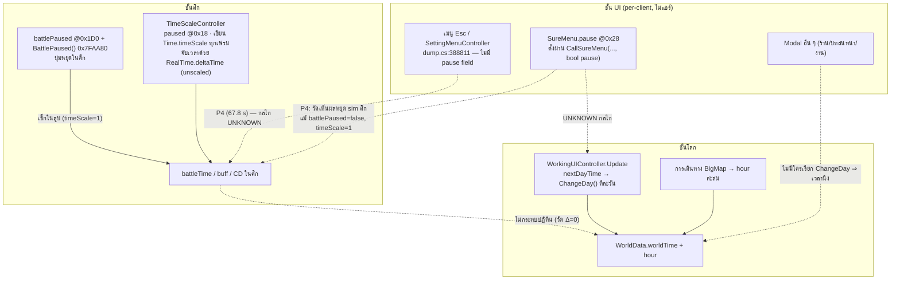
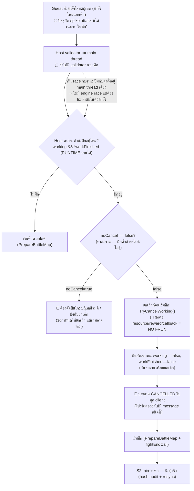

# time-followup-notes — Pause / ระยะเวลา Interactive / การยกเลิกฝึกเมื่อถูกโจมตี (read-only)

> สืบค้นรอบ 2 — 2026-10-27 · **read-only 100%**: ไม่เปิดเกม · ไม่ติด hook · ไม่เขียนไฟล์/เซฟ
> · ไม่แก้ `time-notes.md` (รอบนี้เป็นไฟล์แยก) · ไม่ commit
> ต่อยอดจาก `time-notes.md` — คำถามรอบนี้: (A) ระบบ Pause ของเกมจริง ๆ ทำงานอย่างไร, (B) ตาราง
> 1/5/10/15 วัน → 10/60/90/120 วินาที (ไม่เชิงเส้น) ควรวางที่จุดใด, (C) ยกเลิกการฝึกเมื่อผู้เล่นถูกโจมตี
> ป้าย: **RUNTIME** = วัดจาก process/ไฟล์จริง · **DUMP** = จาก `Il2CppDumper/dump.cs` ·
> **GUESS** = อนุมาน · **UNKNOWN** = หลักฐานไม่พอ · **NOT-RUN** = ต้อง session อนุมัติแยก

---

## 1. Pause architecture — เกม pause จริงด้วยอะไรบ้าง

### 1.1 ชั้นทั้งหมดที่พบ (ตอบข้อสรุปเดิม "ไม่พบ paused flag" ว่ายังไม่ครบ)

| # | ชั้น | ตัวแปร/เมธอด | ครอบคลุมอะไร | หลักฐาน |
|---|---|---|---|---|
| P1 | **UI-modal pause** | `SureMenu.pause @0x28` + `CallSureMenu(text, fuc, param, tag, canCancel, **bool pause**, cancelFuc, cancelParam)` ×8 overload | โต้ตอบยืนยันที่เปิดแบบ "หยุดรอ" — ผู้เรียกเลือกเองว่า pause หรือไม่ | DUMP — dump.cs:391572–391660 (SureMenu, TypeDefIndex 8621) |
| P2 | **Battle-local pause** | `BattleController.battlePaused @0x1D0` + `BattlePaused()` 0x7FAA80 + `BattlePauseButtonClicked(GameObject)` 0x7FAA10 | นาฬิกาศึก (`battleTime`/turn) แช่โดย **เงื่อนไขเช็กในลูป ไม่ใช่ timeScale** — วัดแล้ว timeScale=1 ตลอด 16/16 รอบ | RUNTIME — dump.cs:363056/363073/363403/363624 + S1.5g Phase A |
| P3 | **Slow-mo stack (เอนจิน)** | `TimeScaleController { paused @0x18, nowSlowTimeScale @0x1C, slowTimeDatas }` + `SetSlowTime(t, scale)` → เขียน `Time.timeScale` | เฉพาะ hit-stop/slow-mo ศึก/คัตซีน — **`Update` เขียน `timeScale` ทุกเฟรม** (ไม่มี slow-mo ⇒ บังคับคืน 1.0), `if (paused) return;` | RUNTIME disasm — battle-notes §6 · **ใหม่รอบนี้:** มันวัดเวลาด้วย **`RealTime.get_deltaTime()` (RVA 0xCFD4A0, `RealTime : MonoBehaviour` dump.cs:353269)** = delta **unscaled ไม่โดน timeScale** (แก้สมการจาก VA 0x2DFDD4A0 ที่ battle-notes บันทึกไว้: 0x2DFDD4A0 − 0x2D2E0000 = 0xCFD4A0) |
| P4 | **กลไกที่ยังไม่ระบุชื่อ** | — | เมนู Esc หยุด sim ศึกได้จริง **แม้ `battlePaused=false` และ `timeScale=1`** (วัด 67.8 s ที่ `battleTime`/`turnIndex` นิ่งสนิทขณะ frame เดิน ~128 fps) | RUNTIME (ผล) / **UNKNOWN** (กลไก) — S1.5g |
| P5 | **App-lifecycle pause** | `OnApplicationPause(bool)` | override มีเฉพาะ **คลาส SDK auth**: `CISAuthSDKController` (dump.cs:366487, OnApplicationPause :366524) และ `CISAccountSessionChecker` (291306/:291319) — **เขตห้ามแตะ** ตามกฎข้อ 5 · `Application.runInBackground` ตรวจไม่ได้จากไฟล์เกม (binary, grep `globalgamemanagers` = 0 hit) | DUMP (มีจริง) / ผลต่อ gameplay UNKNOWN · confounder เดิม: หน้าต่างไม่ focus แล้วค่านิ่ง (worldmap-notes §2.2) — ยังแยกไม่ขาด |
| P6 | **Pause ของปฏิทินโลก** | **ไม่มี** | ปฏิทินเดินเฉพาะเมื่อมีใครเรียก `ChangeDay()` หรือ `hour` สะสมจากการเดินทาง — modal/เมนูไม่มีผลเพราะไม่มีใครเรียก | RUNTIME/DUMP — worldmap-notes §2.4 + time-notes §2 |

**ทำไมข้อเดิม "ไม่พบ paused flag" จึงต้องแก้คำ:** ข้อเดิมถูกพูดในขอบเขต *field ของ GameController/WorldData* —
ยังถูกต้อง (P6) แต่ธง pause ของเกมกระจายอยู่ใน **คลาส UI/ศึก** (`SureMenu.pause`, `battlePaused`,
`TimeScaleController.paused`) ไม่ได้อยู่ศูนย์กลาง — grep รอบแรกไล่ไม่ครบเพราะ noise จากไลบรารี
Tween/Steamworks; รอบนี้กรองด้วยช่วงบรรทัดเกม (360000–400000) จึงเห็น — ยืนยันด้วยหลักฐาน ไม่ใช่การคาดเดา

### 1.2 Global Pause: ผลต่อ timer แต่ละชนิด (ตารางตัดสินใจ)

| Timer | กลไกที่ใช้ (ตามหลักฐาน) | หยุดด้วย `timeScale=0`? | หยุดด้วย P2/P4? | ควรหยุดตอน Global Pause? |
|---|---|---|---|---|
| ปั๊มงาน `WorkingUIController.Update` (`nextDayTime`) | มี `Update()` ของตัวเอง (0x9CB4B0); **ไม่รู้ว่าอ่าน `Time.deltaTime` หรือ `RealTime.deltaTime`** (body มองไม่เห็น) | ถ้า scaled = หยุด; ถ้า RealTime = **ไม่หยุด** | UNKNOWN | **ควรหยุด** (อยู่ในนิยาม "เวลาของกิจกรรม") |
| นาฬิกาศึก `battleTime`/buff/CD ในศึก | เช็ก `BattlePaused()` ในลูป + `GetBattleDeltaTime` | หยุด (ถ้า scaled) + P2 ครอบแล้ว | หยุดอยู่แล้ว | ควรหยุด |
| ปฏิทิน (ผ่านปั๊มงาน) | `ChangeDay()` เฉพาะเมื่อปั๊มเดิน | ตามปั๊ม | ตามปั๊ม | ควรหยุด |
| `hour` จากการเดินทาง | สะสมตามระยะใน `BigMapController.Update` (delta แบบไหน UNKNOWN) | น่าจะหยุดถ้า scaled | UNKNOWN | ควรหยุด |
| Weather `weatherLastTime` | `ChangeWeatherLastTime(deltaTime)` 0xC18A90 (delta แบบไหน UNKNOWN) | ถ้า scaled = หยุด | UNKNOWN | **ให้ผู้ใช้ตัดสิน** (ambient — หยุด/เดินต่อได้ทั้งคู่) |
| Transport ของ mod (S2 TCP, heartbeat, NTP ping) | .NET socket + Stopwatch (ฝั่ง mod) | **ไม่หยุด — ห้ามหยุด** (ต้องใช้ส่งคำสั่ง Resume) | ไม่กระทบ | ห้ามหยุด |
| Slow-mo ภายใน (ตัว `TimeScaleController` เอง) | `RealTime.deltaTime` — **unscaled** | ไม่หยุด | — | ไม่สำคัญ |

**ข้อค้นพบสำคัญ:** `TimeScaleController.Update` **เขียน `Time.timeScale` ใหม่ทุกเฟรม** (ถ้าไม่มี slow-mo
จะบังคับคืน 1.0) ⇒ mod ที่แค่ set `timeScale=0` จะถูกทับทันที — ทางที่หลักฐานรองรับคือ set
`TimeScaleController.paused=true` (ทำ Update return ก่อนเขียน) **แล้ว** set `timeScale=0` — แต่เส้นทางนี้
**ยังไม่ครอบ** timer ที่ใช้ unscaled (`RealTime.deltaTime`) และยังไม่รู้ว่าปั๊มงานใช้ delta แบบไหน
[GUESS จาก disasm + field layout — NOT verified at runtime]

### 1.3 แผนภาพชั้น Pause

---

## 2. Activity timing inventory + ตาราง mapping

### 2.1 ตารางกิจกรรม (entry point / แหล่งจำนวนวัน / timer / จุดเดินวัน)

| กิจกรรม | Entry point (RVA) | จำนวนวันมาจาก | Timer จริง | จุดเดินวัน | จบกิจกรรม | Pause | MP |
|---|---|---|---|---|---|---|---|
| งานผลิต | `BuildingUIController.ProduceBuildingWork(string)` 0xB6D580 → `WorkingUIController.StartWorking` | UI สร้างตอนรัน (เซ็ต {1,5,10} / {5,10,15} ต่างกันตามงาน — Observed-UI จากภาพหน้าจอผู้ใช้) | static `dayTime`=1 วิ/วัน + `pauseTime`=0.25 วิ [RUNTIME] | `Update()` 0x9CB4B0 → `ChangeDay()` leaf ทีละวัน | `leftWorkingDay==0` → `StopWorking(true)` → `finishFuc` | UNKNOWN | ต้อง mirror |
| Wait | `WaitUIController.SureButtonClicked()` (slider **1..30 วัน**, dump.cs:392394) | สไลเดอร์ | เดียวกัน | เดียวกัน | เดียวกัน | UNKNOWN | ต้อง mirror |
| ฝึกวิชา/ดาวใน | `StudyFightSelf` 0xB7B530 / `StudyFightOther` 0xB7B480 / `StudyInternalSelf` 0xB7B880 → `ChooseController` → `StartWorking(GetSkillMartialClubStudyTime())` | ผล `GetSkillMartialClubStudyTime` (วัดแล้ว 2 วัน) | เดียวกัน (`workingFuc=null`) | เดียวกัน | `finishFuc` ผ่าน PlotController [GUESS] | UNKNOWN | ต้อง mirror |
| งานสังคม/ช่วยงาน | `PlotController.StartWorking(string)` — `"ชื่องาน;วัน;callFucParam;finishFuc;finishFucParam"` (ตัวอย่างจริง `巡查;3`, `打杂;5`) | **ฝังในสตริง** | เดียวกัน | เดียวกัน | `finishFuc` ในสตริง | UNKNOWN | ต้อง mirror |
| ศึก/ชนิดอื่นของลานฝึก | `StudyLivingSkill(string)` 0xB7BB90 · `StudyMaxLivingSkill` 0xB7D440 · `StudyMaxFightSkill` 0xB7C8C0 · `StudyMaxState` 0xB7DFB0 · `ProduceBuildingSteal` 0xB6CB10 · `AreaBuildingWork(string)` 0xB61C60 · `BreakThroughSkill` 0xB63250 · `ManageTag` 0xB6AF50 · `IdentifyItem` 0xB69500 · `HomeRest` 0xB682A0 · `HotelRest` (dump.cs:366319) · `SimpleWork` :366322 · `DoctorWork` :366328 · `HospitalCureInjury` :366334 | แปรผัน (DUMP เท่านั้น) | น่าจะปั๊มเดียวกัน [GUESS] | เดียวกัน | แปรผัน | UNKNOWN | ต้อง mirror |
| วิจัย/สมาธิ/ยาพิษ/หนังสือ/สร้างอาคาร | `ManageWeaponResearch` 0x7D4B70 / `ManageMeditation` 0x7CE9E0 / `ManageSpePoison` 0x7D3D90 / `BookWriterData.workPercent` / `AreaBuildingData.buildTimeLeft` (มี `noCancel @0x24`, dump.cs:368249) | `leftTime` (หน่วยวัน) | **ไม่มีปั๊ม real-time ให้เห็น** — น่าจะเดินทีละวันผ่าน housekeeping ของ `ChangeDay()` [GUESS — caller ของ Manage* ยังไม่พบ] | รายวัน (GUESS) | `leftTime==0`/`finished` | ตาม day-tick | อยู่ใน world state |
| เดินทาง | `SetPlayerMoveTargetArea` ฯลฯ | — (ตามระยะ) | `hour` += ~0.0157 ชม./หน่วย (r=0.839) | ครบ ~24 ชม. → วันเดิน [GUESS] | ถึงพื้นที่ | UNKNOWN | ต้อง mirror |
| ศึก | `BattleController.PrepareBattleMap` ×11 → `StartBattle` 0x822140 | — | `battleTime` วินาทีจริง + `timeLimit` | **ไม่แตะปฏิทิน** | `CheckBattleEnd` | P2/P4 ครอบ | **มี mirror แล้ว (S2)** |

### 2.2 Mapping 1/5/10/15 วัน → 10/60/90/120 วินาที (ข้อกำหนดล่าสุด — ไม่เชิงเส้น)

โมเดลที่วัดได้: `รวม ≈ N×dayTime + N×pauseTime` (งาน 10 วัน ≈ 12.5 วิ = 10×(1+0.25) ✓ [RUNTIME]) —
ตารางใหม่จึงต้อง set `dayTime` **ต่อการเริ่มกิจกรรม** ตาม N ที่เลือก ไม่ใช่คูณค่าเดียว:

| N (วันที่เลือก) | เวลาเป้าหมาย | dayTime ต่อวัน (สมมติ pauseTime=0) | หมายเหตุ |
|---:|---:|---:|---|
| 1 | 10 s | 10.0 s | |
| 5 | 60 s | 12.0 s | |
| 10 | 90 s | 9.0 s | |
| 15 | 120 s | 8.0 s | |
| N อื่น (Wait slider 1–30, งานที่ให้เลือกชุดอื่น) | — | **ยังไม่ระบุ — ห้ามกำหนดแทนผู้ใช้** | บันทึกแยก |

**ประเด็นที่ห้ามมองข้าม — "แก้ `dayTime` จุดเดียวยังพิสูจน์ไม่ได้ว่าพอ" เพราะเหลือ 4 คำถาม:**

1. `Update()` อ่าน **scaled หรือ unscaled delta** (กำหนดว่า pause ด้วย timeScale ครอบปั๊มไหม) — UNKNOWN
2. เมนู Esc / focus-loss หยุดปั๊มหรือไม่ (P4/P5) — UNKNOWN
3. ปุ่ม `>>` ที่ dayTime ใหม่ — หลักฐานเดิมชี้ว่า **skip ไม่ได้เร่งข้าม dayTime** (hook นับ 10 leaf hits
   ใน 10.5 วิ ที่ dayTime=1 ⇒ skip ตัดแค่ช่วง pauseTime ~0.25 วิ) ดังนั้นที่ 8–12 วิ/วัน `>>` จะยังใช้
   60–120 วิ — สอดคล้อง design แต่ต้องยืนยันซ้ำ [GUESS, n=1]
4. cutscene/งานรายวันที่แทรกระหว่างวัน (ช่องไฟ hook แปรผัน 0.75–2.9 วิ) จะทำให้ระยะจริงคลาดจากตาราง
   — ต้องวัดจริงที่ rate ใหม่

### 2.3 จุดวาง mapping (เปรียบเทียบ — ยังไม่เลือก)

| จุดวาง | วิธี | ข้อดี | ความเสี่ยง |
|---|---|---|---|
| **(α) static `dayTime`+`pauseTime` ตอน StartWorking** (host) | mod set ตาม N ที่เพิ่งเริ่ม (อ่าน `totalWorkingDay`) ผ่าน typed interop — field private static เข้าถึงได้ด้วย interop | ปฏิทิน/housekeeping/callback ครบเดิม (จำนวน `ChangeDay()` = N คงเดิม) · จุดแก้เดียว | static แชร์ทั้งโปรเซส ⇒ ต้อง serialize กิจกรรมทีละงาน · ต้องปิด 4 คำถามข้างบนก่อน |
| (β) Harmony prefix บน `StartWorking` | จับตอนเริ่มเสมอ ไม่ต้อง poll | ครอบทุก caller รวม plot-string | เป็น hook — ต้องอนุมัติ · เสี่ยงกว่า (α) |
| (γ) server config table (`net.cfg`-style) | host อ่านตาราง {1:10, 5:60, 10:90, 15:120} แล้ว apply ด้วย (α) | ปรับได้ไม่ต้อง build ใหม่ — ตรงข้อกำหนด "Server กำหนด" | เป็นชั้นบนของ (α) ไม่ใช่ทางเลือกคู่ขนาน |
| (δ) timer ใหม่ฝั่ง server แยกจาก UI | mod จับเวลาเอง เรียก `ChangeDay()` เอง | authority ชัดสุด | ต้องเลียน per-day callback ทั้งหมด — **ไม่มีหลักฐานรองรับ** (callback เป็นสตริงกระจายใน data) |

UI ที่แสดง (`waitTimeText`, progress) อ่านจากปั๊มชุดเดียวกับกลไกจบกิจกรรม (`nextDayTime`/`leftWorkingDay`)
⇒ แหล่งเวลาเดียวกันในเครื่อง host [RUNTIME จาก field layout + พฤติกรรมที่วัด]

---

## 3. Training cancellation flow — ฝึกอยู่แล้วถูกโจมตี

### 3.1 หลักฐานชิ้นส่วนที่มีอยู่จริง

- **เส้นเริ่มฝึก:** `StudyFightSelf` 0xB7B530 → `ChooseController` (RUNTIME: `chooseType=HeroSkill`,
  `sendResultFuc="StudyFightSelfChoosen"`, `targetHero=heroID 0`) → `StartWorking(2, …)` — RUNTIME (area-notes P1-6)
- **เส้นเริ่มศึกกับผู้เล่น:** เกมต้นฉบับ **ไม่มี PvP** — เส้นที่ใกล้ที่สุดคือ NPC โจมตีผู้เล่น:
  plot → `PlotStartFight(string fightParam)` (dump.cs:382928) → `PrepareBattleMap(…, fightEndCall="NpcAttackPlayerResult~…")`
  → ผลที่ `NpcAttackPlayerResult/Hurt/Release/Finish` (dump.cs:386451–386460, ใน PlotController —
  คลาสเริ่ม 382605) — DUMP (โครงสร้าง) · ฝั่ง mod มีช่องสั่ง host แล้ว 2 ชนิด: `spike move`/`spike attack`
  (`AttackCommand.cs` เรียก `BattleController.BattleGridClicked(grid)` เท่านั้น, **ในศึกเท่านั้น**,
  gate ด้วย `AllowRemoteInput` + `TurnGate` + JitProbe) — RUNTIME (โค้ด)
- **ตรวจว่ากำลังฝึกอยู่:** `WorkingUIController.working && !workFinished` (`skipping` ใช้ไม่ได้ — ค้าง true
  หลังจบ) — RUNTIME · singleton นี้มีต่อโปรเซส host เท่านั้น ⇒ สถานะ "ฝึก" มีความหมายฝั่ง host เดียว
- **เส้นยกเลิก:** `TryCancelWorking()` 0x9CB330 + `StopWorking(bool finished)` 0x9CB220 + ธง `noCancel`
  สองชั้น — `WorkingUIController.noCancel @0x61` (ตั้งผ่าน overload `StartWorking(…, bool _noCancel)`,
  dump.cs:392736) และ `AreaBuildingData.noCancel @0x24` (dump.cs:368249) — **ผลของการยกเลิก (คืน resource?
  รางวัลบางส่วน? callback?) ยังไม่เคยวัดเลย = NOT-RUN** · ปุ่ม "ยกเลิก" มีจริงบน dialog งาน (Observed-UI)
- **จุดเชื่อม "เริ่มศึก ⇒ ยกเลิกงาน" ในเกม:** ไม่พบทั้ง dump.cs และ evidence — เกมเดี่ยวไม่มีเหตุการณ์นี้ ·
  NPC โจมตีระหว่าง modal งานเปิด = ไม่เคยวัด (UNKNOWN)

### 3.2 Flow เป้าหมาย (▢ = ยังไม่มี implementation รองรับ — เป็นของใหม่ทั้งหมด)

**จุดระวัง (ตามข้อกำหนด §2D.7):**
- **โจมตีชนจังหวะงานจบ:** ยกเลิกได้เฉพาะช่วง `working && !workFinished` — ถ้า `workFinished=true`
  ไปแล้ว รางวัลถูกจ่ายผ่าน `finishFuc` และยกเลิกไม่ได้ (กัน "จ่ายรางวัล + ยกเลิก" พร้อมกัน)
- **โจมตีระหว่าง Pause:** คำสั่งโจมตีตอน pause ควรถูก validator ปฏิเสธหรือเข้าคิว — **ให้ผู้ใช้ตัดสิน**
- **คำสั่งซ้ำ/disconnect:** ต้องมี reqId แบบ `TIME_ACTION_*` (ร่างไว้ใน area-notes) + สถานะกิจกรรม
  เก็บฝั่ง host ไม่พึ่งเครื่อง guest
- **ข้อสังเกตแยก (ไม่ขยายขอบเขต):** งานผลิต/สร้างอาคารมี `noCancel` ของตัวเอง (`AreaBuildingData`) —
  ถ้าอนาคตต้องการยกเลิกงานอื่นจะเจอธงเดียวกันนี้ซ้ำ

---

## 4. Risk assessment — 3 ทางเลือก

| มิติ | (1) ปรับ timer เดิม (`dayTime`/`pauseTime` ต่อ StartWorking) | (2) Server timer ใหม่แยกจาก UI เดิม | (3) ผสม: server กำหนดระยะ + คง day-tick เดิม |
|---|---|---|---|
| ปฏิทิน | +N วันตามเดิม (จำนวน `ChangeDay()` = N) | ออกแบบใหม่ทั้งชุด — เสี่ยง housekeeping พัง | +N วันตามเดิม |
| AI / resource / event / เงินเดือน | ไม่เปลี่ยนเชิงสถานะ — แค่กระจายตามเวลาจริงนานขึ้น | ต้องเรียก day-tick เอง — **หลักฐานไม่พอ** (leaf body ยังไม่ถูกอ่าน) | ไม่เปลี่ยน |
| callback กิจกรรม | ครบเดิม (`workingFuc`/`finishFuc` ของเกม) | ต้องเลียน callback สตริงทั้งหมด — เสี่ยงสูงสุด | ครบเดิม |
| Global Pause | พึ่งคำตอบ scaled/unscaled ของปั๊ม | ง่ายสุด — หยุด timer ของ mod เอง | ต้อง gate ปั๊มแยกอีกชั้น |
| Save/Load | ไม่เปลี่ยน (งานค้างน่าจะหายเหมือนเดิม [GUESS]) | ต้องเพิ่ม mod-state เก็บกิจกรรม | (1) + mod-state ของ pause flag |
| Combat ยกเลิกฝึก | ใช้ `TryCancelWorking` ของเกมตรง ๆ (รอวัดผล) | เขียนระบบยกเลิกเอง | เหมือน (1) |
| Multiplayer | host เดินปั๊มอยู่แล้ว — เพิ่ม mirror สถานะ + pause/ack | authority ชัดแต่โค้ดใหม่เยอะ | สมดุลที่สุดตามหลักฐาน |
| ความเสี่ยงรวม | **ต่ำสุด** — จุดแก้ 2 static field, rollback = คืนค่า 1/0.25 | สูงสุด | ต่ำ–กลาง |

ทาง (3) ในทางปฏิบัติคือ (1) + config ของ server + ชั้น Global Pause — หลักฐานปัจจุบันหนุน (1)/(3)
มากกว่า (2) อย่างชัดเจน

---

## 5. Follow-up implementation plan (เสนอเท่านั้น — ห้ามลงมือ)

**ขั้นที่ 0 — session อ่านอย่างเดียว (ต้องขออนุมัติแยก, บนสำเนาเซฟ):**
1. disassembly `ChangeDay()` leaf 0x790E30 → housekeeping ใดอยู่ใน leaf
2. หาจุด write ของ `WorldData.hour` (read-watch ระหว่างเดิน)
3. วัด `WorkingUIController.Update` ระหว่าง (ก) เมนู Esc (ข) หน้าต่าง unfocus (ค) slow-mo —
   สังเกต `nextDayTime`/`leftWorkingDay` นิ่งหรือเดิน → ตอบ P4, P5 และ scaled-vs-unscaled
- **เกณฑ์ผ่าน:** disasm + จุด write + ตารางพฤติกรรม 3 เคส · เซฟจริง digest ไม่เปลี่ยน · ไม่ผ่านถ้ามี write เกิดขึ้น

**ขั้นที่ 1 — ยกเลิกฝึก (ต้องอนุมัติเพราะ invoke):** บนสำเนาเซฟ: เริ่มฝึก 2 วัน → `TryCancelWorking()` →
สังเกต (ก) `working/workFinished/totalWorkingDay` (ข) ทรัพยากร/เงินก่อน-หลัง (ค) `finishFuc` ถูกเรียกไหม
(ง) ปฏิทินเดินกี่วัน · **ผ่าน = คำตอบครบ 4 ข้อ + เซฟคืน baseline เป๊ะ; ไม่ผ่าน = รายงานก่อนต่อ**

**ขั้นที่ 2 — ตาราง mapping (หลังขั้น 0):** host mod set `dayTime` = ตาราง {1:10, 5:60, 10:90, 15:120}
(config ฝั่ง server) ตอน StartWorking บนสำเนาเซฟ · A/B กับงาน 5 วัน · **เกณฑ์:** จบใน 60±2 วิ, ปฏิทิน +5 พอดี,
`hour` คงที่, ผลผลิตรวมเท่า A, `>>` ไม่ลัดระยะ, เซฟจริงไม่เปลี่ยน

**ขั้นที่ 3 — Global Pause (หลังขั้น 0):** บนสำเนา: `TimeScaleController.paused=true` + `timeScale=0` →
วัดว่าปั๊มงาน/ศึก/เดินทางหยุดจริงหรือบางส่วน · **ถ้าปั๊มใช้ unscaled delta จะไม่ผ่าน** → ต้องออกแบบ gate ที่ปั๊มใหม่

**ขั้นที่ 4 — protocol:** เพิ่ม `PAUSE/RESUME(ack)`, `WORKING_STATE`, `ACTIVITY_CANCELLED` ต่อยอด
FrameCodec/SeqTracker ที่มี — ออกแบบใน S2-plan รอบใหม่ รออนุมัติ

---

## 6. คำถาม 10 ข้อ (คำตอบสั้น)

1. **Pause ผ่านกลไกใด?** 4 ชั้น + 1 ไม่รู้จัก: `SureMenu.pause` / `battlePaused`+`BattlePaused()` 0x7FAA80 /
   `TimeScaleController.paused`→`timeScale` / P4 จากเมนู Esc (วัดเห็นผล 67.8 s แต่ระบุตัวไม่ได้)
2. **Pause เดิมหยุดอะไรบ้าง?** ไม่เหมือนกัน — P2/P4 เฉพาะศึก, P3 เฉพาะ scaled time (และเขียน timeScale ทับ
   ทุกเฟรมจนกว่า paused), **ไม่มีชั้นใดหยุดปฏิทิน**, activity pump = UNKNOWN
3. **Global Pause ต้องอาศัยอะไร?** mod flag ฝั่ง host (fail-closed) + gate `TimeScaleController.paused`+`timeScale`
   **ถ้า**ปั๊มใช้ scaled delta + message `PAUSE/RESUME`+ack + guest ไม่มีเส้นเดินเวลาของตัวเอง (โครงปัจจุบันเป็นจริงแล้ว)
4. **ตาราง mapping เชื่อมที่จุดใด?** static `dayTime`/`pauseTime` (dump.cs:392696–392697) set ต่อ StartWorking
   ตาม N — โมเดล `รวม ≈ N×(dayTime+pauseTime)` [GUESS จาก 2 การวัด] — ห้ามสรุปว่าพอก่อนปิด 4 คำถาม §2.2
5. **day-tick/resource/AI/callback ตามเดิมไหม?** เชิงสถานะน่าจะครบ (จำนวนวัน = N เท่าเดิม) [GUESS] ·
   เชิงจังหวะเวลาจริงกระจายกว่าขึ้น → ต้องจัดลำดับคิวคำสั่ง
6. **ยกเลิกฝึกปลอดภัยไหม + ผล resource/reward?** เครื่องมือมีจริง (`TryCancelWorking` + สถานะอ่านได้) แต่
   **ผลยังไม่มีหลักฐานเลย (NOT-RUN)** และ `noCancel` ของการฝึกไม่เคยอ่านค่า
7. **จัดลำดับ Complete vs Attack/Cancel อย่างไร?** main thread เดียว (controller singleton ทั้งหมด) ⇒
   คำสั่งเข้าคิวเดียวกับ day-tick; ยกเลิกเฉพาะ `working && !workFinished`; งานจบก่อนคำสั่งมาถึง = จ่ายรางวัลแล้ว
   ศึกเริ่มหลัง (ไม่มี double-outcome) — ใช้ reqId + สถานะฝั่ง host [GUESS — โครงคิวมีจริง]
8. **ต้องเพิ่ม protocol/state อะไร?** `PAUSE/RESUME`+ack, `WORKING_STATE`, `ACTIVITY_CANCELLED`,
   คำสั่งโจมตีนอกศึก+validator — ปัจจุบัน TCP รับแค่ Ping/Resync/Bye (S2ControlHandler.cs:76–96, RUNTIME)
9. **จุดเสี่ยงสูงสุด + หลักฐานขาด?** (1) body ของ `ChangeDay()` leaf (2) scaled-vs-unscaled ของปั๊ม
   (3) พฤติกรรม `TryCancelWorking` (4) กลไก P4 (5) focus-loss ต่อ host ที่ alt-tab (6) ระยะเวลาของ N นอก {1,5,10,15}
10. **การทดลองเล็ก-ปลอดภัยสุดถัดไป?** ขั้นที่ 0 (อ่านอย่างเดียว 3 รายการ) — ไม่มี invoke/write แต่ปลดล็อก
    ทุกการตัดสินใจ ตามด้วยขั้นที่ 1 (TryCancelWorking บนสำเนา)

---

## 7. ดัชนีหลักฐาน

| ข้อเท็จจริง | ไฟล์/ที่มา |
|---|---|
| SureMenu API (`CallSureMenu(..., bool pause)`), fields | `Il2CppDumper/dump.cs:391572–391660` |
| Battle pause chain (`battlePaused`, `BattlePaused()` 0x7FAA80, `BattlePauseButtonClicked` 0x7FAA10) | dump.cs:363056/363073/363403/363624 + `battle-notes.md §1–2` |
| TimeScaleController เขียน timeScale ทุกเฟรม + paused short-circuit | `battle-notes.md §6` (disasm) |
| `RealTime.get_deltaTime()` RVA 0xCFD4A0 = unscaled helper (แก้จาก VA 0x2DFDD4A0) | dump.cs:353269–353276 (รอบนี้) + battle-notes §6 |
| เมนู Esc หยุด sim 67.8 s (battlePaused=false, timeScale=1) · ปุ่มหยุดศึก 16/16 timeScale=1 | `evidence/S1.5g-20261021-160331/` + AGENTS |
| `SettingMenuController` ไม่มี pause field, มี autoSave dropdown | dump.cs:388811–388935 |
| `OnApplicationPause` เฉพาะ CISAuth SDK | dump.cs:366524, 291319 |
| Entry points กิจกรรม (RVA) + `noCancel` 2 ชั้น | dump.cs:366001+ (BuildingUIController), 368249 (AreaBuildingData), 392679+ (WorkingUIController) |
| `PlotStartFight(string)` / `NpcAttackPlayerResult*` | dump.cs:382928, 386451–386460 (PlotController เริ่ม 382605) |
| งาน/Wait/ฝึกวัดจริง (dayTime=1, pauseTime=0.25, จบเอง, hour คงที่, skip cadence) | `area-notes.md P1-4..P1-7` + `evidence/S2cd-20261022-0710/measurement-skip{1,2}.md` |
| โมดัง: spike attack/move, TurnGate, S2 TCP ไม่มีคำสั่งเกม | `src/LongYinCoop/S1.5/AttackCommand.cs`, `MoveCommand.cs`, `TurnGate.cs`, `src/LongYinCoop/S2/Host/S2ControlHandler.cs`, `IpcServer.cs` |
| S2 mirror เฉพาะศึก (battleKey/turnIndex/nowActiveState/battleTime/units) | `src/LongYinCoop/S2/Host/S2Sampler.cs:95–140` |
| พื้นฐานระบบเวลา (worldTime/hour/ChangeDay/ปั๊มงาน/weather/events) | `time-notes.md` (รอบ 1 — ไม่แก้ในรอบนี้) |
| แบบร่าง protocol `AREA_SNAPSHOT`/`TIME_ACTION_*` | `area-notes.md` (ท้ายไฟล์) |
